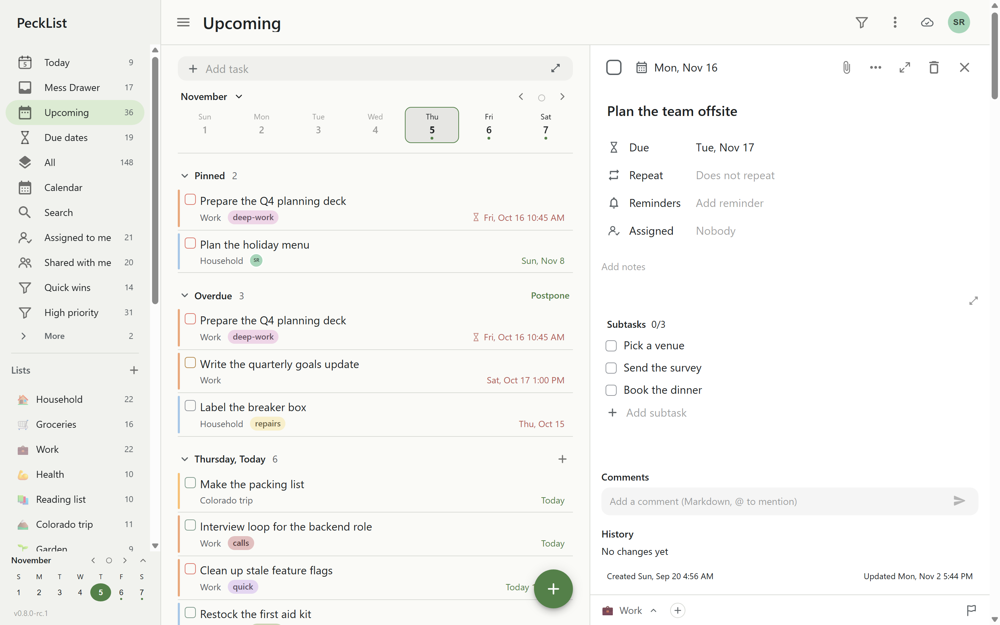
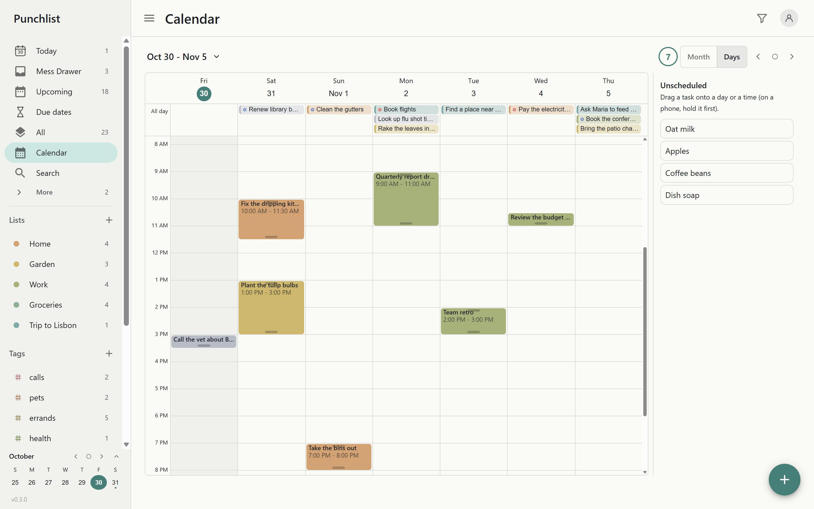

# PeckList

[](https://gitlab.com/killswitch10/punchlist/-/pipelines)
[](https://gitlab.com/killswitch10/punchlist/-/releases)
[](LICENSE)
[](https://docs.pecklist.com/)
[](docs/using/android-app.md#install)

A self-hosted, offline-first task and calendar app. Lists, subtasks, tags, dates and a calendar you
drag tasks onto, shared with the people you choose, on every device, online or not. One small
server keeps everyone's data, in SQLite or PostgreSQL, and runs as a Docker container or a native
program on Linux and Windows.

<!-- The status line: at 1.0, replace this one line with "> **Status: 1.0.** Stable; see the [changelog](CHANGELOG.md)." -->

> **Status: before 1.0.** In daily use, but a minor version may still change things: every change you need to act on is under **Breaking changes** in the [changelog](CHANGELOG.md). Keep backups.

<p align="center">
  
  
</p>

## Features

- **Tasks**: subtasks, sections, nested tags, priorities, start and due dates, times and spans, rich
  notes and checklists, and one-line quick add (`Call the vet tomorrow 3pm #pets !high`).
- **Views**: Today, Upcoming, Due dates, All, Closed, Assigned to me, Shared with me, filters, search, and a
  month/week/day calendar with drag in, move and resize.
- **Offline first**: an installable PWA with a full local copy; changes merge per field across
  devices and people, without conflicts.
- **Sharing**: friends, groups and shared lists with roles; assign tasks to people or groups.
- **For admins**: single sign-on with any OIDC provider (group checks, role and group mapping,
  provider migration), roles and server groups, view-as for support, scheduled backups with
  whole-server and per-person restore, an access and event log, logs to Loki, Elasticsearch,
  Graylog, OpenTelemetry or syslog, usage stats, and settings from the environment, a file or the
  admin page (encrypted secrets supported).

Why it exists, and how it compares with Todoist, TickTick, Vikunja, Nextcloud Tasks and Super
Productivity (including what they do better): [why PeckList](docs/about/why.md) and
[the comparison](docs/about/comparison.md). What comes next: [roadmap](docs/about/roadmap.md).

## Quick start

```bash
docker run -d --name pecklist -p 8080:8080 -v pecklist-data:/data -v pecklist-files:/files \
  registry.gitlab.com/killswitch10/punchlist:latest
docker logs pecklist     # the first admin password, printed once
```

Open <http://localhost:8080>, sign in as `admin` with that password, and choose a new one. The
image is public: amd64 and arm64, tagged `latest`, a minor line (`0.3`) and each version (`0.3.0`).
For real use, see the documentation:

|           |                                                                                                                                                                                                                |
| --------- | -------------------------------------------------------------------------------------------------------------------------------------------------------------------------------------------------------------- |
| Install   | [Docker](docs/install/docker.md) · [Docker Compose](docs/install/docker-compose.md) · [Linux](docs/install/linux.md) · [Windows](docs/install/windows.md) · [From source](docs/install/from-source.md)         |
| Set up    | [First start](docs/getting-started/first-start.md) · [Reverse proxy and HTTPS](docs/install/reverse-proxy.md) · [Single sign-on](docs/guides/single-sign-on.md)                                                |
| Configure | [How settings work](docs/configuration/index.md) · [All settings](docs/configuration/reference.md) · [Settings file](docs/configuration/config-file.md) · [Database](docs/configuration/database.md)           |
| Run it    | [Backups](docs/guides/backups.md) · [Upgrading](docs/guides/upgrading.md) · [Logs and audit](docs/guides/logging.md) · [Security](docs/guides/security.md) · [Troubleshooting](docs/guides/troubleshooting.md) |
| Use it    | [Tour](docs/using/index.md) · [Moving from TickTick or Todoist](docs/using/moving-from-ticktick-or-todoist.md) · [The Android app](docs/using/android-app.md) · [Privacy](docs/using/privacy.md)               |
| Reference | [Command line](docs/reference/cli.md) · [HTTP API](docs/reference/http-api.md) · [FAQ](docs/faq.md)                                                                                                            |
| Examples  | [`examples/`](examples/): Compose files, a settings file, proxy configs, Linux and Windows service files                                                                                                       |

The same docs are published as a site from `main` (GitLab Pages).

## Downloads

Each [release](https://gitlab.com/killswitch10/punchlist/-/releases) has the image
(`registry.gitlab.com/killswitch10/punchlist:<version>`, amd64 and arm64), self-contained Linux
(x64, arm64) and Windows (x64) downloads, the signed Android app (`pecklist-android.apk`, also
through [Obtainium](docs/using/android-app.md#install)), and `SHA256SUMS`.

## Help and community

- Questions and problems: [getting help](docs/about/support.md). Bugs:
  [how to report one](docs/about/reporting-bugs.md).
- Community chat: a Discord server opens with 1.0 (link to come).
- Demo: a public demo server opens with 1.0 (link to come).

## Contributing

Issues and merge requests are welcome. Start with [CONTRIBUTING.md](CONTRIBUTING.md) and
[developing](docs/development/index.md); look for issues labelled `good first issue` and
`help wanted`. Everyone follows the [code of conduct](CODE_OF_CONDUCT.md). Report security
problems privately: [SECURITY.md](SECURITY.md).

The project lives on GitLab: [gitlab.com/killswitch10/punchlist](https://gitlab.com/killswitch10/punchlist).
The copy on GitHub ([KillSwitchIO/PeckList](https://github.com/KillSwitchIO/PeckList)) is a
read-only mirror, updated from GitLab: open issues and merge requests on GitLab, not pull
requests on GitHub.

## License

Copyright (C) 2026 Ben Dimit. PeckList is free software under the
[GNU Affero General Public License, version 3 or later](LICENSE): use it, host it, change it and
share it, for any purpose. If you run a modified version for other people over a network, offer
them its source under the same license.

Organizations that cannot work under the AGPL can buy a
[commercial license](COMMERCIAL-LICENSE.md). Contributions are accepted under the terms in
[CONTRIBUTING.md](CONTRIBUTING.md#license-and-contributions).
