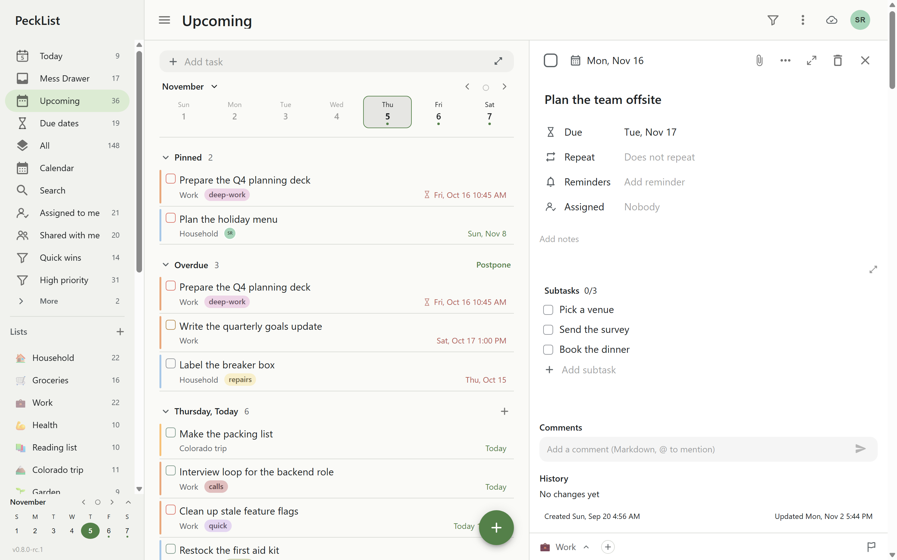
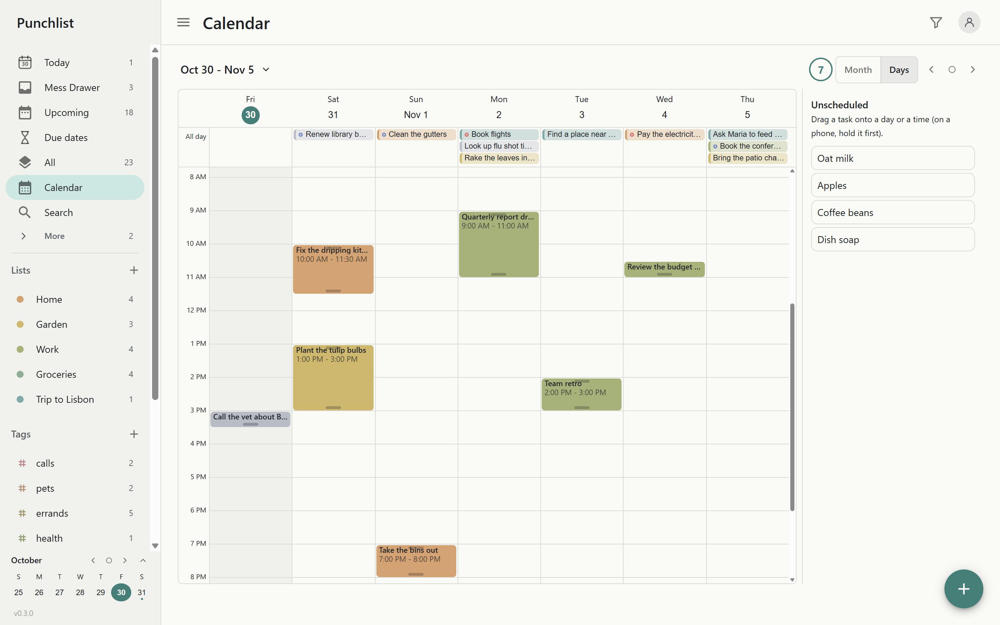

# PeckList

PeckList is a self-hosted task and calendar app: lists, subtasks, tags, dates and a calendar you
drag tasks onto, shared with the people you choose. It works offline on every device and syncs
when it can. One small server (a Docker container, or a native program on Linux and Windows)
serves the app and keeps everyone's data, in SQLite or PostgreSQL.

{/* The status line: at 1.0, replace this one line with "**Status: 1.0.** Stable; see the changelog." and its link. */}
**Status: before 1.0.** In daily use, but a minor version may still change things: every change you need to act on is under **Breaking changes** in the [changelog](https://gitlab.com/killswitch10/pecklist/-/blob/main/CHANGELOG.md). Keep [backups](guides/backups.md).

## What it does

- **Tasks** with subtasks, nested tags, priorities, start and due dates, times and time
  spans, rich notes and checklists. Type a whole task in one line:
  `Call the vet tomorrow 3pm #pets !high`.
- **Views**: Today, Upcoming, Due dates, All, Closed, Assigned to me, Shared with me, saved filters,
  search, and a calendar (a continuous month, 1 to 14 days on a time grid, and a year shaded by how busy each day is) to drag tasks in, move them and stretch them.
- **Offline first**: an installable web app (PWA) that keeps working without a connection and
  merges changes from every device without conflicts.
- **Sharing**: friends, groups and shared lists; assign tasks to people or groups.
- **For the person running it**: single sign-on with any OpenID Connect provider, roles and server
  groups, scheduled backups and restore, per-person export, access and event logs, logs to Loki,
  Elasticsearch, Graylog, OpenTelemetry or syslog, usage stats, and settings from the environment,
  a file or the admin page.

## Where to start

| You want to                                    | Read                                                                                                  |
| ---------------------------------------------- | ----------------------------------------------------------------------------------------------------- |
| Try it in two minutes                          | [Quick start](getting-started/quick-start.md)                                                         |
| Run it for real with Docker                    | [Docker Compose](install/docker-compose.md), then [reverse proxy and HTTPS](install/reverse-proxy.md) |
| Run it without Docker                          | [Linux](install/linux.md) or [Windows](install/windows.md)                                            |
| Sign in with Authentik, Pocket ID, Keycloak... | [Single sign-on](guides/single-sign-on.md)                                                            |
| Change a setting                               | [How settings work](configuration/index.md) and [all settings](configuration/reference.md)            |
| Back up, move or restore                       | [Backups and restore](guides/backups.md)                                                              |
| Fix something                                  | [Troubleshooting](guides/troubleshooting.md)                                                          |
| Move from TickTick or Todoist                  | [Moving from TickTick or Todoist](using/moving-from-ticktick-or-todoist.md)                           |
| Put it on your Android phone                   | [The Android app](using/android-app.md)                                                               |
| Decide whether it is for you                   | [Why PeckList](about/why.md) and [the comparison](about/comparison.md)                               |

## Getting help

See [getting help](about/support.md). In short: open an issue on
[GitLab](https://gitlab.com/killswitch10/pecklist/-/issues), and for a bug
([how to report one](about/reporting-bugs.md)) attach a
[debug dump](guides/logging.md#debug-dump): it carries logs, settings and versions but no task
content, passwords or keys. Report security problems privately as described in
[SECURITY.md](https://gitlab.com/killswitch10/pecklist/-/blob/main/SECURITY.md).
